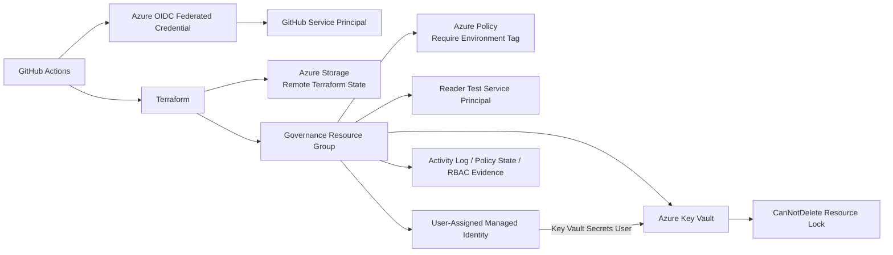

# Azure Identity, Security & Governance Platform

Azure Cloud Engineering portfolio project focused on identity, RBAC, Key Vault, managed identities, Azure Policy, governance, security controls, and automation with Terraform.

## Project Status

**Current phase:** Complete  
**Overall progress:** 100%

## What This Project Demonstrates

- Azure RBAC and least-privilege access
- Service principals and user-assigned managed identities
- Azure Key Vault with RBAC authorization
- Azure Policy and governance enforcement
- Resource locks
- Azure Activity Log and policy compliance evidence
- Terraform-first Infrastructure as Code
- Remote Terraform state in Azure Storage
- GitHub Actions CI
- Azure OIDC authentication with no stored client secret
- Deliberate security and governance failure tests

## Architecture

## Project Roadmap

- [x] Create project structure
- [x] Create Terraform foundation
- [x] Create governance resource group
- [x] Create custom policy requiring the `Environment` tag
- [x] Assign the policy at resource-group scope
- [x] Prove policy denial using a deliberately non-compliant storage account
- [x] Create a dedicated test service principal
- [x] Assign Reader access at resource-group scope
- [x] Validate read vs write RBAC behaviour
- [x] Add user-assigned managed identity
- [x] Add Azure Key Vault
- [x] Prove managed identity secret retrieval
- [x] Configure remote Terraform state
- [x] Add Key Vault deletion protection with a resource lock
- [x] Add monitoring and audit evidence
- [x] Add GitHub Actions validation
- [x] Configure Azure OIDC authentication
- [x] Complete final architecture and troubleshooting documentation

## Validation Evidence

- Azure Policy denied creation of a storage account without the required `Environment` tag with `RequestDisallowedByPolicy`.
- A Reader-scoped service principal could read the project resource group but was denied `Microsoft.Storage/storageAccounts/write` with `AuthorizationFailed`.
- A user-assigned managed identity retrieved a Key Vault secret using Azure RBAC without a stored application password.
- The Key Vault `CanNotDelete` management lock blocked an attempted deletion with `ScopeLocked`.
- GitHub Actions authenticated to Azure using OIDC with no client secret stored in the repository.

## Monitoring and Audit Evidence

- Azure Activity Log captured management operations including container lifecycle actions, management lock creation, RBAC changes, Key Vault changes, and managed identity creation.
- Azure Policy state showed the custom `require-environment-tag` policy evaluating project resources as compliant.
- RBAC listing confirmed the dedicated test service principal retained the `Reader` role at the project resource-group scope.

## CI/CD and OIDC Validation

The GitHub Actions workflow performs:

- `terraform fmt -check -recursive`
- `terraform init -backend=false`
- `terraform validate`
- Azure login using `azure/login` and OIDC
- Azure resource-group access verification

No long-lived Azure client secret is stored in GitHub.

## Troubleshooting and Engineering Lessons

### Policy enforcement

A storage account deployment without the required `Environment` tag was denied by Azure Policy. Redeploying with the required tag satisfied the governance rule.

### Least-privilege RBAC

A dedicated service principal was intentionally assigned only the `Reader` role at resource-group scope. It could inspect the resource group but was denied a storage-account write operation, proving that read and write permissions were correctly separated.

### Key Vault RBAC

The signed-in user was initially denied permission to create a Key Vault secret. Assigning `Key Vault Secrets Officer` at Key Vault scope resolved the write failure without broadening access across the subscription.

### Managed identity

A temporary Azure Container Instance used the user-assigned managed identity to obtain a token and retrieve a Key Vault secret. This demonstrated secret access without embedding an application password in the workload.

### Resource protection

A `CanNotDelete` management lock on the Key Vault blocked an intentional deletion attempt with `ScopeLocked`, proving protection against accidental deletion.

### Terraform state

Remote state is stored in Azure Storage, so Terraform state survives Cloud Shell restarts and can be shared safely across sessions.

## Key Takeaway

This project demonstrates how identity, policy, secrets management, resource protection, auditability, Infrastructure as Code, and secretless CI authentication work together as a single Azure governance platform.
